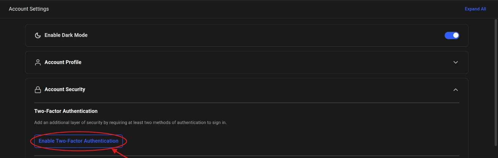
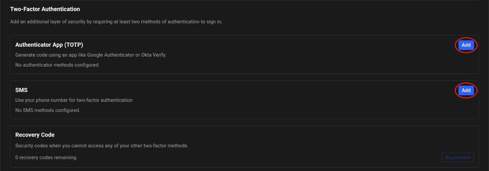
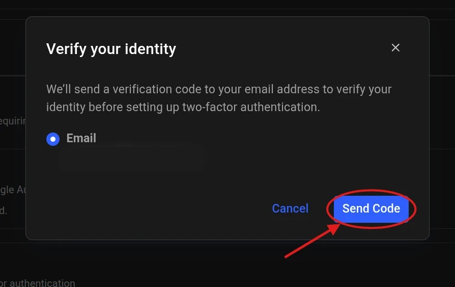
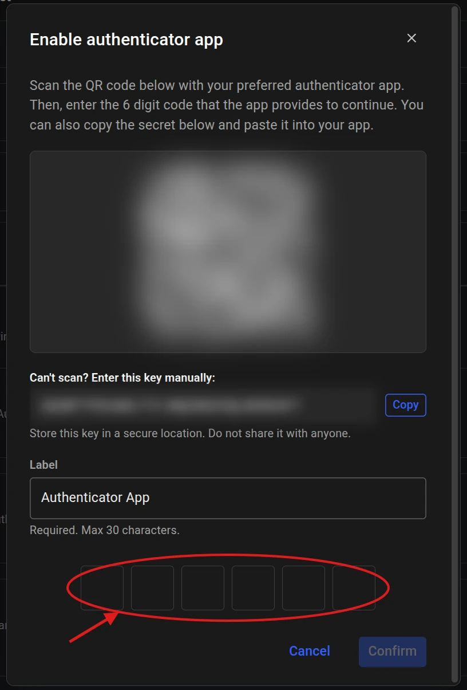
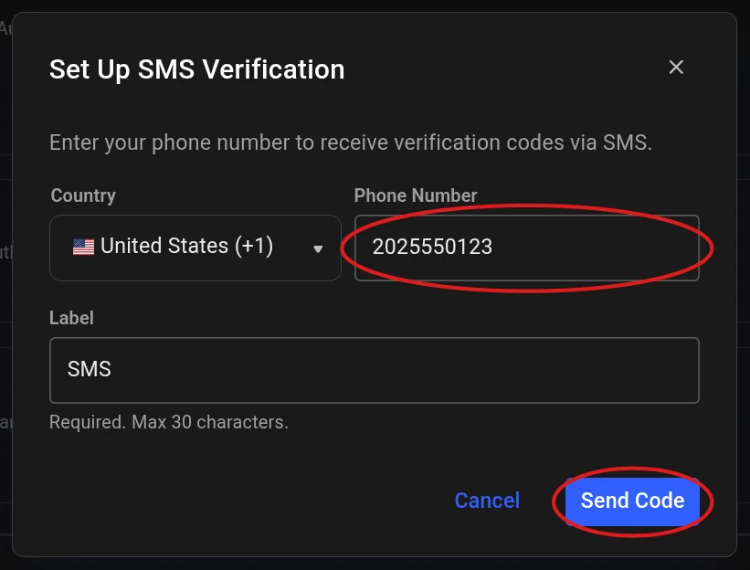
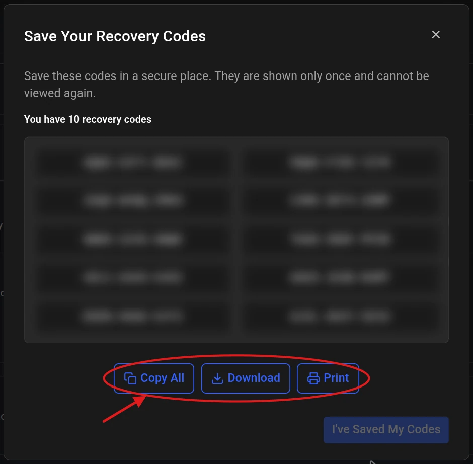
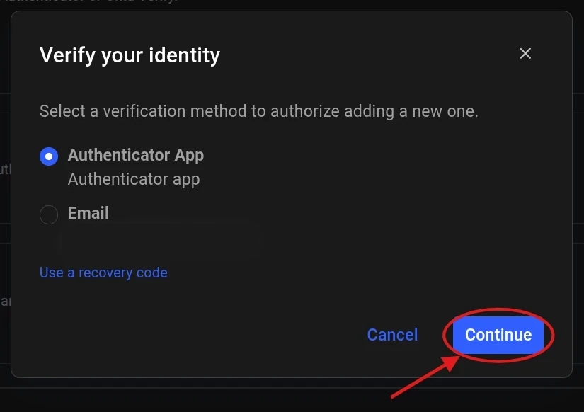
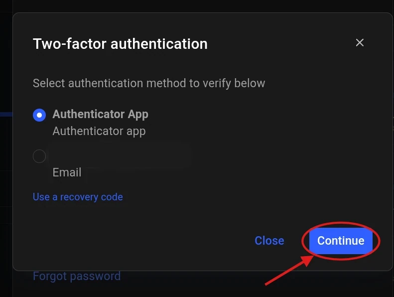
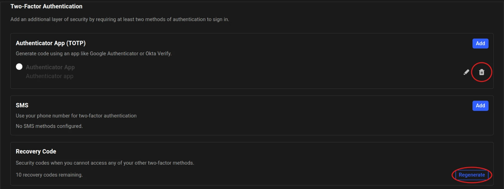

Two-factor authentication (2FA) asks for a one-time code after your password, so
someone who learns your password still cannot sign in as you.

You turn 2FA on by adding an **authenticator app** or **SMS** method. Email is not
a method you add — it is a fallback channel that is always available on your
account.

| Method | How you get the code |
| --- | --- |
| **Authenticator App (TOTP)** (recommended) | Generated by an app such as Google Authenticator, Authy, or Okta Verify |
| **SMS** | Texted to your mobile phone |
| **Email** | Sent to your account email, only when you pick it at a verification prompt |

<Note>
Email is used automatically once: to confirm it is you while adding your *first*
method, since you have nothing else to verify with yet. After that it is never sent
on its own, but you can still choose it at any verification prompt.
</Note>

---

## Turn on 2FA

<Steps>
  <Step title="Open Account Security">
    Go to [Account Settings](https://cloud.vast.ai/settings/), expand **Account
    Security**, and click **Enable Two-Factor Authentication**.

    <Frame caption="Enable Two-Factor Authentication in Account Security">
      
    </Frame>
  </Step>
  <Step title="Choose a method">
    The section expands to list the available methods. Click **Add** next to
    **Authenticator App (TOTP)** or **SMS**.

    <Frame caption="Each method has its own Add button">
      
    </Frame>
  </Step>
  <Step title="Confirm it is you">
    Select **Email** and click **Send Code**, then enter the 6-digit code sent to
    your account email and click **Verify**.

    <Frame caption="Verifying by email before adding your first method">
      
    </Frame>
  </Step>
  <Step title="Set up the method">
    <Tabs>
      <Tab title="Authenticator App">
        Scan the QR code with your authenticator app. If you cannot scan it, copy
        the key under **Can't scan? Enter this key manually** into the app
        instead.

        Give the method a **Label** (up to 30 characters), enter the 6-digit code
        the app shows, and click **Confirm**.

        <Frame caption="Setting up an authenticator app">
          
        </Frame>
      </Tab>
      <Tab title="SMS">
        Choose your **Country**, enter your **Phone Number**, give the method a
        **Label** (up to 30 characters), and click **Send Code**.

        Enter the 6-digit code from the text message to finish. The code is valid
        for 10 minutes.

        <Frame caption="Setting up SMS codes">
          
        </Frame>
      </Tab>
    </Tabs>
  </Step>
  <Step title="Save your recovery codes">
    2FA is now on, and you are shown 10 one-time recovery codes. Save them with
    **Copy All**, **Download**, or **Print** — somewhere outside your phone, such
    as a password manager — then click **I've Saved My Codes**.

    <Frame caption="Recovery codes shown after 2FA is turned on">
      
    </Frame>

    <Warning>
    The codes are shown only once. They are the only way back into your account
    if you lose your phone.
    </Warning>
  </Step>
</Steps>

### Add a second method

Adding another method — SMS as a backup to an authenticator app, for example —
follows the same steps with one difference: in **Confirm it is you**, no email is
sent automatically. You choose an existing method, email, or **Use a recovery
code**, then click **Continue**.

<Frame caption="Verifying with an existing method before adding another">
  
</Frame>

---

## Sign in with 2FA

After your password, the **Two-factor authentication** prompt lists your
methods. Select one, click **Continue**, and enter the code:

| Method | What to do |
| --- | --- |
| **Authenticator App** | Enter the current code from the app |
| **SMS** | Enter the texted code. **Resend** becomes available after 30 seconds |
| **Email** | Enter the code sent to your account email |
| **Use a recovery code** | Enter one of your saved codes in place of a 6-digit code |

<Frame caption="Choosing a method at sign-in">
  
</Frame>

---

## Manage your methods

Everything below is under **Account Settings → Account Security**. Each change
asks you to verify with an existing method or a recovery code first.

<Frame caption="2FA methods and recovery codes in Account Security">
  
</Frame>

- **Regenerate recovery codes** — click **Regenerate** to get a fresh set of 10.
  Every earlier code stops working.
- **Remove a method** — click the remove icon next to it. Removing your last
  method turns 2FA off.

---

## Limits

| | |
| --- | --- |
| **Code validity** | 10 minutes |
| **SMS resend** | Available after 30 seconds |
| **Failed attempts** | 3 for SMS, 5 for an authenticator app |
| **Lockout** | 15 minutes, on the method that failed only — your other methods and recovery codes still work |
| **Recovery codes** | 10 per set, each usable once |

---

## Troubleshooting

<AccordionGroup>
  <Accordion title="My SMS code did not arrive">
    - Wait 30 seconds, then click **Resend**.
    - Check the phone number on file.
    - Make sure your phone has signal and is not filtering messages from unknown
      numbers.

    If it still does not arrive, sign in with another method or a recovery code,
    or contact [support@vast.ai](mailto:support@vast.ai).
  </Accordion>
  <Accordion title="My code says it has expired">
    Codes last 10 minutes. Start the sign-in again to get a new one.
  </Accordion>
  <Accordion title="My authenticator app code is rejected">
    - Make sure your phone's clock is set automatically — authenticator codes
      depend on accurate time.
    - Check you are using the Vast.ai entry in the app, not an older one.
    - If it still fails, remove the entry from the app and set the method up
      again.
  </Accordion>
  <Accordion title="I am locked out after too many attempts">
    Only the method that failed is locked, for 15 minutes. Switch to another
    method or a recovery code at the prompt, or wait out the lockout.
  </Accordion>
  <Accordion title="I lost my phone and have no recovery codes">
    Contact [support@vast.ai](mailto:support@vast.ai) with your account email.
    Support will verify your identity and help you regain access.
  </Accordion>
  <Accordion title="Account Settings asks me to migrate my 2FA">
    Your account uses the legacy SMS 2FA. Click **Regenerate Recovery Codes** in
    the banner and follow the steps to move to the current system and get your
    recovery codes.
  </Accordion>
</AccordionGroup>

---

## Related

- [Account Settings](/guides/reference/account-settings) — the rest of the
  Account Security section
- [CLI two-factor authentication](/cli/two-factor-authentication) — set up and
  use 2FA from `vastai`
- [2FA API endpoints](/api-reference/two-factor-authentication-endpoints) — the
  REST endpoints behind these flows
